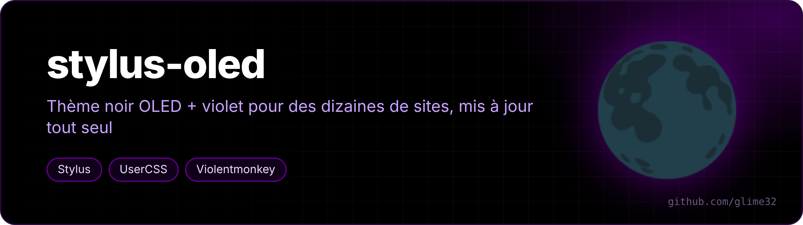
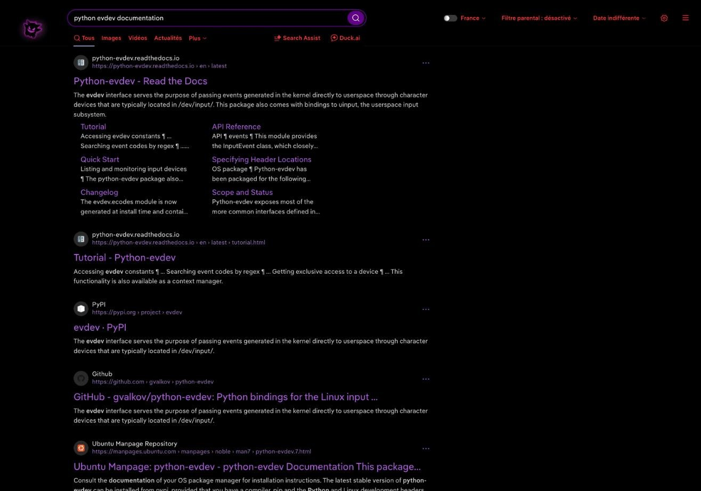
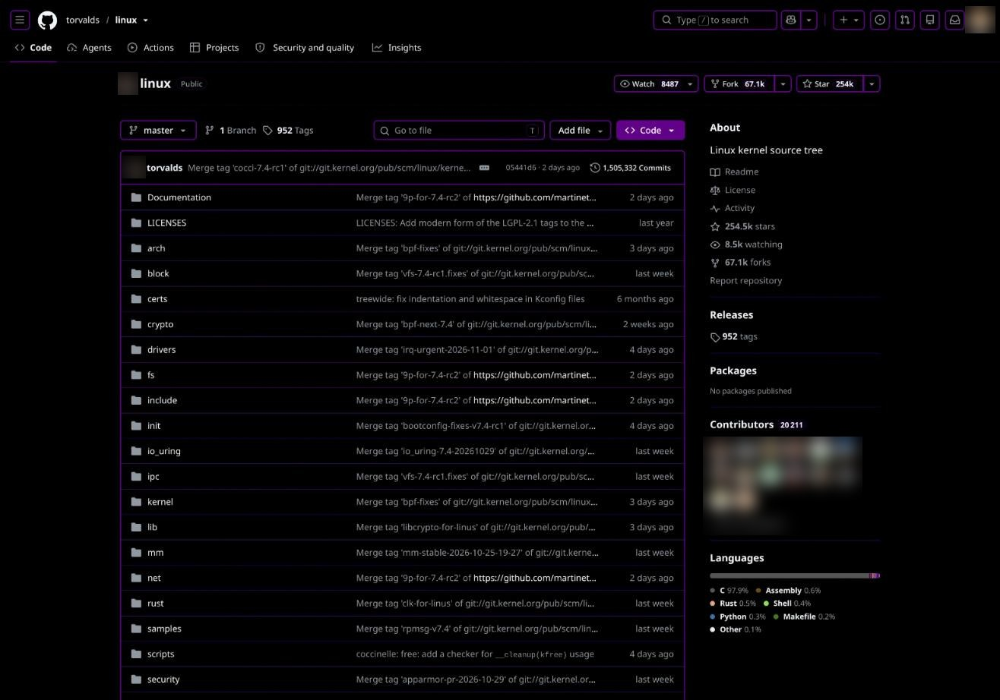
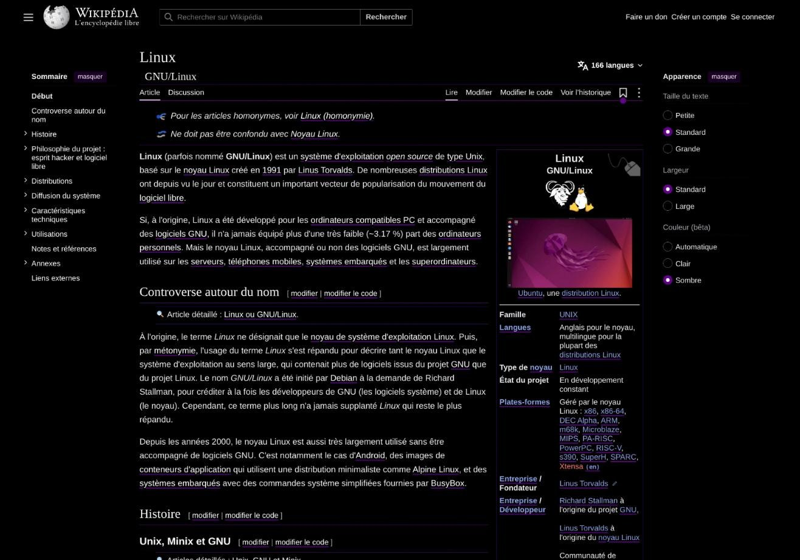
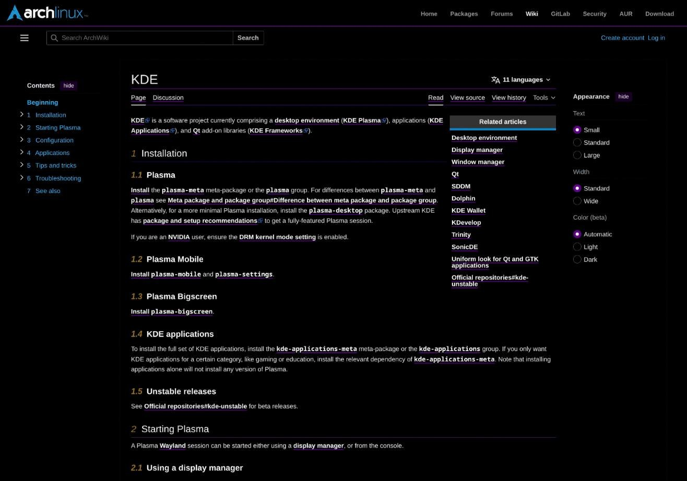
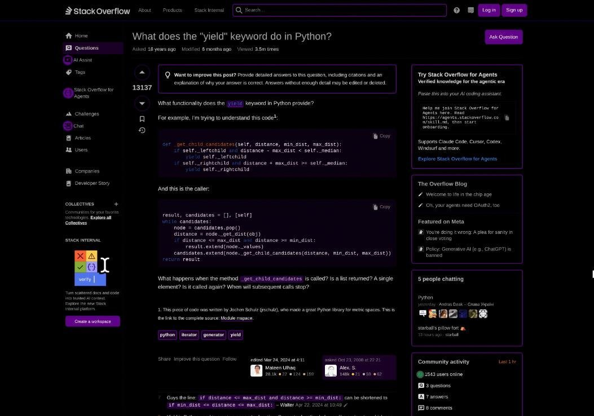
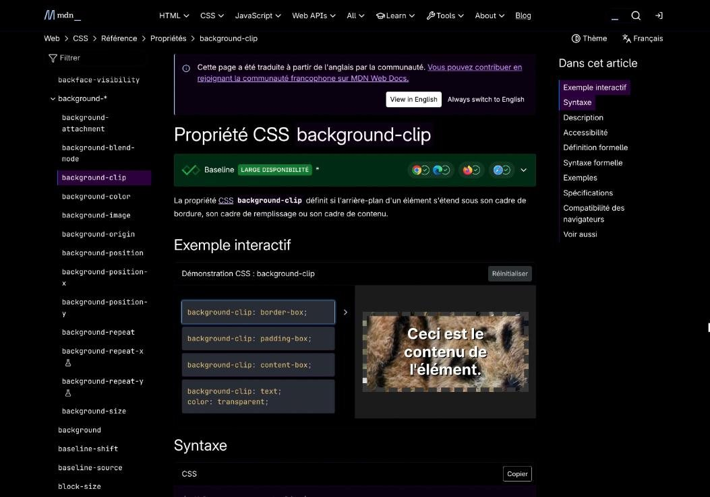

<p align="center"></p>

<p align="center">  </p>

<p align="center"><a href="README.md">🇬🇧 English version</a></p>

Mon thème noir OLED + violet pour à peu près tous les sites que j'utilise, et quelques userscripts qui vont avec. Tout se met à jour tout seul depuis ce dépôt.

Palette : fond `#000000` (pixels éteints sur un écran OLED), un seul violet `#610089` pour les boutons, les bordures 2 px et ce qui est mis en avant (ses versions foncées `#2a003b` / `#14001e` pour les non lus, la sélection et le survol), texte et icônes blancs, liens soulignés en `#610089`, rouge `#ff3b3b` pour le survol et ce qui est « dangereux ».

<table>
<tr><td></td><td></td></tr>
<tr><td align="center"><sub>DuckDuckGo</sub></td><td align="center"><sub>GitHub</sub></td></tr>
<tr><td></td><td></td></tr>
<tr><td align="center"><sub>Wikipédia</sub></td><td align="center"><sub>ArchWiki</sub></td></tr>
<tr><td></td><td></td></tr>
<tr><td align="center"><sub>Stack Overflow</sub></td><td align="center"><sub>MDN</sub></td></tr>
</table>

## Contenu

| Fichier | Extension | Installer |
|---|---|---|
| `oled-violet.user.css` | [Stylus](https://github.com/openstyles/stylus) | [installer](https://raw.githubusercontent.com/glime32/stylus-oled/main/oled-violet.user.css) |
| `youtube-vo.user.js` | Violentmonkey / Tampermonkey | [installer](https://raw.githubusercontent.com/glime32/stylus-oled/main/youtube-vo.user.js) |
| `google-messages-recherche.user.js` | Violentmonkey / Tampermonkey | [installer](https://raw.githubusercontent.com/glime32/stylus-oled/main/google-messages-recherche.user.js) |
| `pdfjs/oled-pdfjs.css` | PDF.js (extension *PDF Viewer* non empaquetée) | une commande, voir [plus bas](#pdfjs--lecteur-pdf) |

Un clic sur « installer » ouvre directement la page d'installation de l'extension. Les fichiers ont un `@updateURL` qui pointe ici, donc chaque modification poussée sur `main` arrive toute seule dans le navigateur.

## oled-violet.user.css

Un seul style qui contient un bloc `@-moz-document` par site, il s'applique tout seul au bon domaine. Une partie des sites couverts :

- **Google** : YouTube, Gmail, Gemini, comptes Google
- **Recherche / savoir** : DuckDuckGo, Wikipédia et les autres wikis Wikimedia, ArchWiki, wiki CachyOS, Stack Exchange, WolframAlpha, docs Python, MDN, Minecraft Wiki, Fandom
- **Fac** : Moodle, CAS et ENT de l'Université de Montpellier
- **Réseaux / messageries** : Discord, WhatsApp Web, Instagram, Snapchat, TikTok, Reddit, LinkedIn
- **Divers** : GitHub, Twitch, Spotify, SoundCloud, Steam, ProtonDB, Chess.com, Modrinth, Desmos, GeoGebra, Zoom, PayPal, Roblox, MangaDex, Scribd, Amazon, AliExpress, claude.ai...

Quelques règles que je garde partout :

- les bordures sur les éléments arrondis font **2 px avec `background-clip: padding-box`** (en 1 px, les coins arrondis paraissent plus fins que le reste) ;
- les liens Aide / Confidentialité / Conditions et les pieds de page inutiles sont cachés ;
- les messages non lus (Gmail, Discord, WhatsApp, Instagram) ressortent en violet avec une barre à gauche ;
- les sites sans mode sombre ont un vrai thème sombre plutôt qu'une inversion de couleurs (seuls les graphiques de Desmos et GeoGebra restent inversés).

Fait et testé sur [Helium](https://github.com/imputnet/helium) (Chromium) sous CachyOS / KDE Plasma. Doit marcher sur n'importe quel navigateur avec Stylus.

## youtube-vo.user.js

Force la piste audio **originale** (pas le doublage automatique de YouTube) et les sous-titres **dans la langue de la vidéo** (pas la traduction automatique). Le script n'agit qu'au moment où YouTube charge une piste ou des sous-titres, il n'y a pas de boucle qui tourne en fond.

Contrepartie : la traduction automatique des sous-titres ne marche plus du tout.

## google-messages-recherche.user.js

Ajoute une barre de recherche dans [Google Messages Web](https://messages.google.com/web), comme dans l'appli Android : filtre les conversations par nom ou par dernier message.

## pdfjs/ — lecteur PDF

Stylus ne peut pas toucher aux pages `chrome-extension://`, donc le lecteur PDF (copie non empaquetée de l'extension *PDF Viewer*, PDF.js) a son propre calque : `oled-pdfjs.css`, chargé juste après `viewer.css`.

- le même style que le reste du thème : icônes blanches (rouges au survol), outil actif dans un rond `#610089`, numéro de page et zoom dans des pastilles noires au bord `#610089` 2 px, menus aux coins arrondis ;
- la barre du haut se cache et descend dès que la souris approche du haut de la page (zone de 48 px), avec une fine ligne violette qui montre où elle est ; elle reste ouverte tant qu'un menu, la recherche ou un outil est ouvert.

```bash
curl -fsSL https://raw.githubusercontent.com/glime32/stylus-oled/main/pdfjs/install.sh | bash
```

Le script trouve le dossier du lecteur (`~/pdfjs-custom` par défaut, ou `PDFJS_DIR=...`), ajoute le CSS et un timer systemd utilisateur qui le met à jour toutes les heures. Recharge ensuite les onglets PDF.

## Voir aussi

- [nouvel-onglet-oled](https://github.com/glime32/nouvel-onglet-oled) : la page Nouvel onglet assortie
