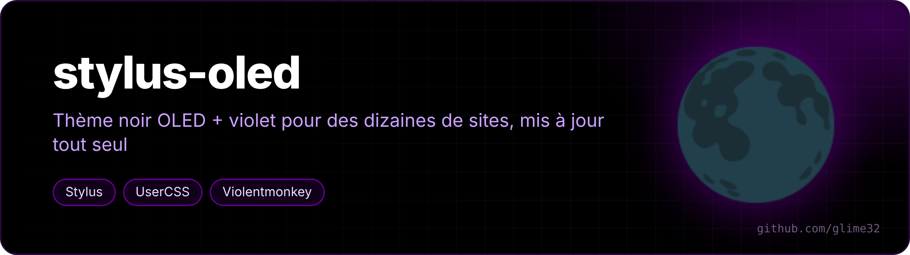
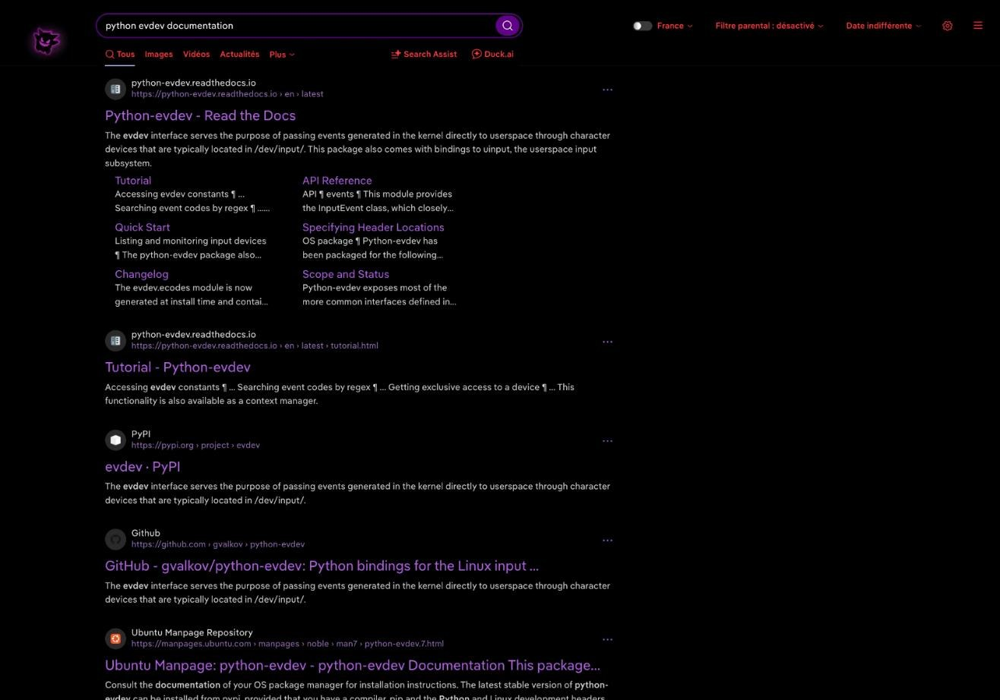
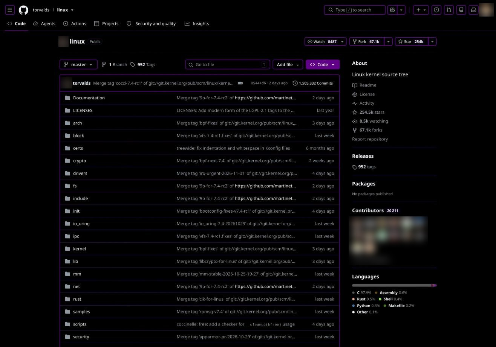
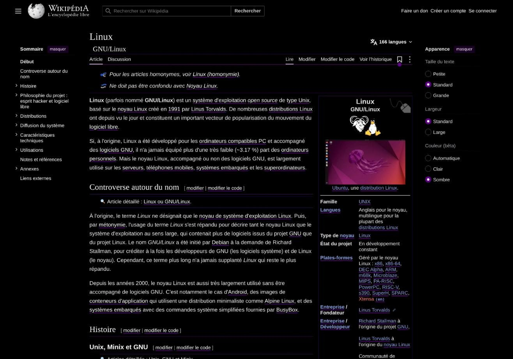
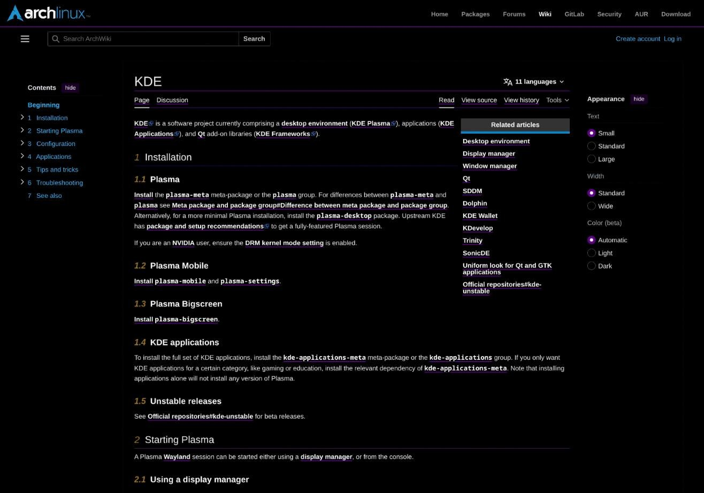

  

<a href="README.fr.md">🇫🇷 Version française</a>

**My OLED black + purple theme for pretty much every site I use**, plus a few userscripts. Everything updates itself from this repo.

Palette: `#000000` background (pixels fully off on OLED screens), purple `#610089`, accent `#c8a2ff`, red `#ff3b3b` for hover and "danger".

<table>
<tr><td></td><td></td></tr>
<tr><td align="center">DuckDuckGo</td><td align="center">GitHub</td></tr>
<tr><td></td><td></td></tr>
<tr><td align="center">Wikipédia</td><td align="center">ArchWiki</td></tr>
</table>

## Install

| File | For | Install |
|---|---|---|
| `oled-violet.user.css` | [Stylus](https://github.com/openstyles/stylus) | [**install**](https://raw.githubusercontent.com/glime32/stylus-oled/main/oled-violet.user.css) |
| `youtube-vo.user.js` | Violentmonkey / Tampermonkey | [**install**](https://raw.githubusercontent.com/glime32/stylus-oled/main/youtube-vo.user.js) |
| `google-messages-recherche.user.js` | Violentmonkey / Tampermonkey | [**install**](https://raw.githubusercontent.com/glime32/stylus-oled/main/google-messages-recherche.user.js) |

One click opens the extension's install page. Each file has an `@updateURL` pointing here.

## oled-violet.user.css

One style with an `@-moz-document` block per site, applied automatically to the right domain. Some of the sites covered:

- **Google**: YouTube, Gmail, Gemini, Google accounts
- **Search / knowledge**: DuckDuckGo, Wikipedia and other Wikimedia wikis, ArchWiki, CachyOS wiki, Stack Exchange, WolframAlpha, Python docs, MDN, Minecraft Wiki, Fandom
- **Social / messaging**: Discord, WhatsApp Web, Instagram, Snapchat, TikTok, Reddit, LinkedIn
- **Other**: GitHub, Twitch, Spotify, SoundCloud, Steam, ProtonDB, Chess.com, Modrinth, Desmos, GeoGebra, Zoom, PayPal, MangaDex, Scribd, Amazon, AliExpress, claude.ai, Université de Montpellier (Moodle, CAS, ENT)…

Rules used everywhere: rounded borders are always **2 px with `background-clip: padding-box`** (1 px borders look thinner in the corners); Help / Privacy / Terms links and useless footers are hidden; unread messages stand out in purple; sites without dark mode use a color inversion that spares images.

## youtube-vo.user.js

Forces the **original audio track** (no auto-dub) and **subtitles in the video's language** (no auto-translate). It only acts when YouTube loads a track or subtitles — no background loop.

## google-messages-recherche.user.js

Adds a search bar to [Google Messages for web](https://messages.google.com/web), like the Android app: filters conversations by name or last message.

## See also

- [nouvel-onglet-oled](https://github.com/glime32/nouvel-onglet-oled) — matching New Tab page
- [soundcloud-mobile](https://github.com/glime32/soundcloud-mobile) — SoundCloud as a mobile app
